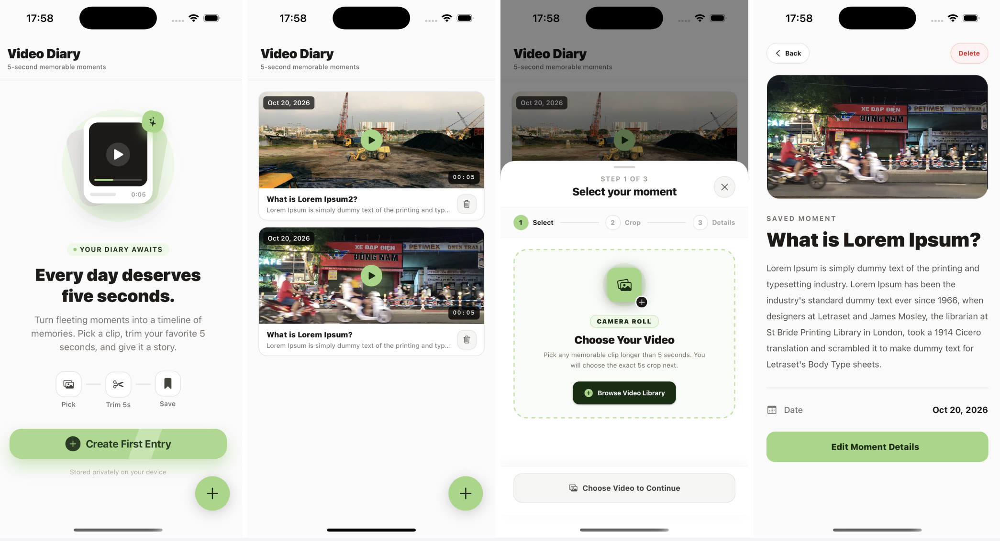

# Video Diary App

A mobile application built with **React Native (Expo)** and **TypeScript** that lets users capture and curate 5-second video memories. Users can pick videos from their device library, trim a 5-second segment using an interactive timeline scrubber, attach a title and description, and manage their collection offline with local SQLite persistence.

<p align="center">
  
</p>

---

## Features

- **Main Page (Clipped Video List)**:
  - Displays saved 5-second video diary entries in an infinite-scrolling list with pull-to-refresh.
  - Persistent JPEG thumbnails generated at save time for fast list rendering.
  - Quick delete action with confirmation modal and automatic local file cleanup.
- **3-Step Crop Modal Workflow**:
  1. **Select**: Pick a video from the device media library (`expo-image-picker`) with minimum duration validation ($\ge 5$ seconds).
  2. **Crop**: Interactive 5-second window scrubber with live video preview (`expo-video`) and frame filmstrip thumbnails.
  3. **Details**: Add a validated Name and Description (`zod`) and trigger asynchronous native trimming (`expo-trim-video`).
- **Details Page**:
  - Full-screen playback of the cropped 5-second video clip, displaying its metadata and creation timestamp, with quick actions to edit or delete.
- **Edit Modal / Screen**:
  - Update the title and description of an existing entry with Zod validation and automatic React Query cache invalidation.

---

## Tech Stack

- **Framework & Navigation**: [Expo](https://expo.dev/) (SDK 58) & [Expo Router](https://docs.expo.dev/router/introduction/) (File-based routing)
- **Styling**: [NativeWind v4](https://www.nativewind.dev/) (Tailwind CSS for React Native)
- **State Management**:
  - **Client/UI State**: [Zustand](https://zustand-demo.pmnd.rs/) (manages multi-step crop modal state)
  - **Async & Server/DB State**: [TanStack Query (React Query v5)](https://tanstack.com/query/latest) (manages SQLite queries, pagination, and trimming mutations)
- **Database & Storage**:
  - `expo-sqlite` for relational metadata persistence (`videos` table with WAL mode and indexed timestamps)
  - `expo-file-system` for storing trimmed MP4 clips and compressed JPEG thumbnails in app document storage
- **Media & Video Processing**:
  - `expo-video` for hardware-accelerated video playback and thumbnail frame generation
  - `expo-trim-video` for native 5-second video segment extraction
  - `expo-image-manipulator` & `expo-image` for thumbnail compression and caching
- **Validation**: [Zod](https://zod.dev/) for form and schema validation

---

## Prerequisites

Because this project uses native video processing modules (`expo-trim-video`, `expo-sqlite`, `expo-video`), **it requires an Expo Development Build (Prebuild)** and cannot be run inside the standard Expo Go client.

Make sure you have the following installed:

- **Node.js** (v18 or newer recommended)
- **npm** or **yarn**
- **iOS (macOS only)**:
  - Xcode (with iOS Simulator installed)
  - CocoaPods (`sudo gem install cocoapods` or `brew install cocoapods`)
- **Android**:
  - Android Studio & Android SDK
  - A configured Android Virtual Device (Emulator) or physical device with USB debugging enabled

---

## Setup & Installation

1. **Clone the repository and navigate to the project folder:**

   ```bash
   git clone <repository-url>
   cd video-diary-app-case
   ```

2. **Install dependencies:**

   ```bash
   npm install
   ```

3. **Run the application (Development Build):**

   - **iOS Simulator (macOS):**
     ```bash
     npx expo run:ios
     ```
     *Note: If the native `ios/` directory is not generated yet or needs updating, Expo will automatically run prebuild and install CocoaPods before compiling.*

   - **Android Emulator / Device:**
     ```bash
     npx expo run:android
     ```

   - **Start Metro Bundler only (after the native app is already installed on your simulator/device):**
     ```bash
     npm start
     ```

---

## Usage Instructions

### 1. Creating a New Video Diary Entry
1. From the **Home Screen**, tap the green **`+`** floating action button in the bottom-right corner (or tap **Import a Video** on the empty state screen).
2. **Step 1 — Select**: Tap **Choose from Library** and grant media library permissions if prompted. Select any video that is at least **5 seconds** long, then tap **Continue to Crop**.
3. **Step 2 — Crop**:
   - Drag the green 5-second selection window along the filmstrip timeline to choose the exact moment you want to keep.
   - Tap the video preview to pause or resume playback of the selected 5-second loop.
   - Tap **Next: Add Details** when satisfied.
4. **Step 3 — Details**:
   - Enter a **Title / Name** (required, up to 100 characters) and an optional **Description** (up to 1000 characters).
   - Tap **Trim & Save to Diary**. The app will natively trim the 5-second clip, generate a cover thumbnail, persist the record to SQLite, and navigate to the new entry's Detail page.

### 2. Viewing & Playing Entries
- On the **Home Screen**, scroll through your saved entries. Pull down to refresh, or scroll to the bottom to load more entries automatically.
- Tap any video card to open the **Detail Screen**, where the 5-second clip plays in a loop alongside its full description and date metadata.

### 3. Editing an Entry
- Open an entry's **Detail Screen** and tap the **Edit** button in the top-right header.
- Modify the **Name** or **Description** and tap **Save Changes**. The list and detail views update immediately.

### 4. Deleting an Entry
- Tap the trash icon on any card on the **Home Screen**, or tap **Delete Entry** on the **Detail Screen**.
- Confirm deletion in the modal. Both the SQLite database record and the local video/thumbnail files on disk are permanently removed.

---

## Project Structure

```text
src/
├── app/                        # Expo Router screens & navigation layouts
│   ├── _layout.tsx             # Root providers (QueryClient, GestureHandler, Stack)
│   ├── index.tsx               # Home screen (paginated video list)
│   ├── crop/index.tsx          # 3-step modal flow for picking, scrubbing & saving
│   ├── videos/[id].tsx         # Video detail & playback screen
│   └── edit/[id].tsx           # Edit video metadata modal screen
├── components/
│   ├── crop/                   # Stepper components (VideoPickerStep, SegmentScrubber, MetadataForm)
│   └── videos/                 # List components (VideoCard, EmptyState, DeleteConfirmModal)
├── hooks/
│   ├── useVideos.ts            # React Query hooks for CRUD & infinite pagination
│   └── useTrimVideoMutation.ts # React Query mutation orchestrating trim + thumbnail + DB insert
├── lib/
│   ├── database/               # SQLite client initialization & schema migrations
│   ├── videoRepository.ts      # Data access layer for SQLite CRUD operations
│   ├── videoTrimmingService.ts # Native video trimming wrapper (expo-trim-video)
│   ├── videoThumbnailService.ts# Frame extraction & JPEG persistence
│   └── videoSchema.ts          # Zod validation schemas for metadata forms
├── store/
│   └── cropStore.ts            # Zustand store for the 3-step crop workflow state
├── types/
│   └── video.types.ts          # Shared TypeScript interfaces
└── utils/
    ├── fileSystem.ts           # Persistent directory management & file cleanup helpers
    └── formatDuration.ts       # Time & duration formatting utilities
```
